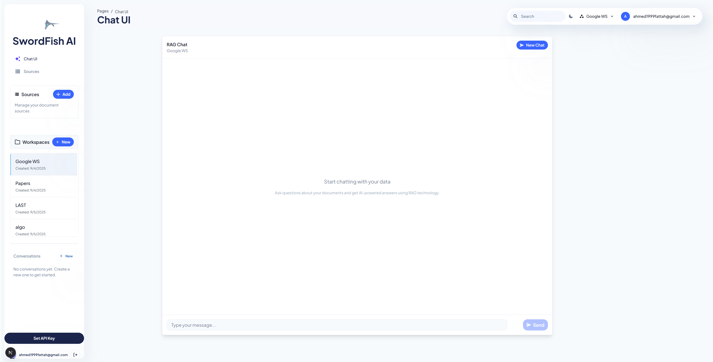
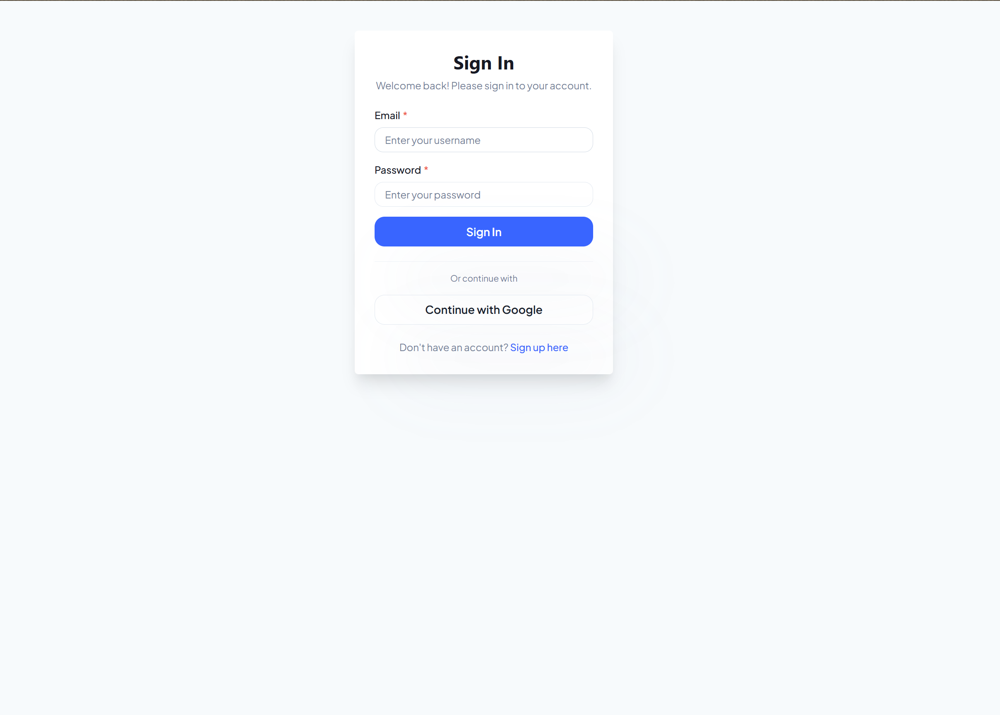
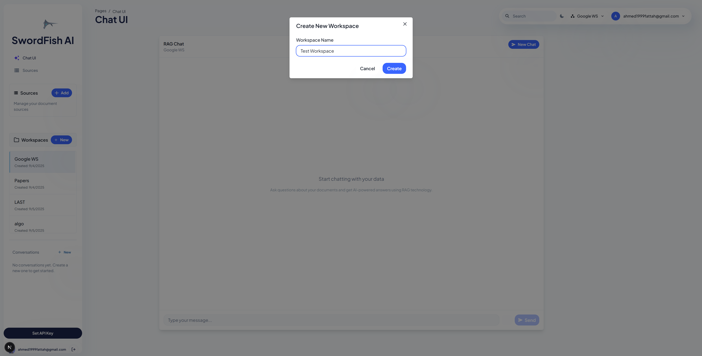
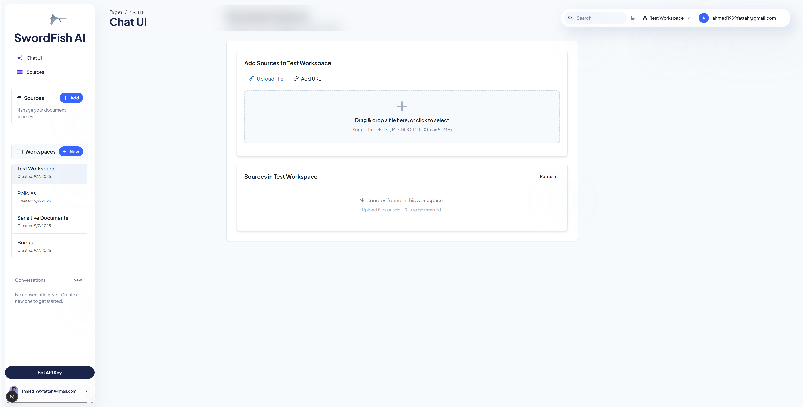
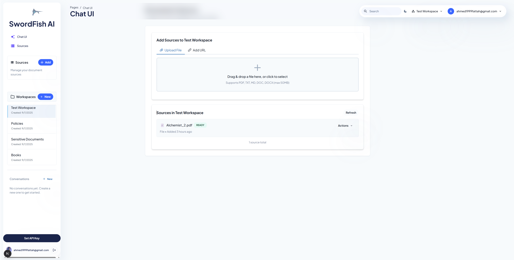
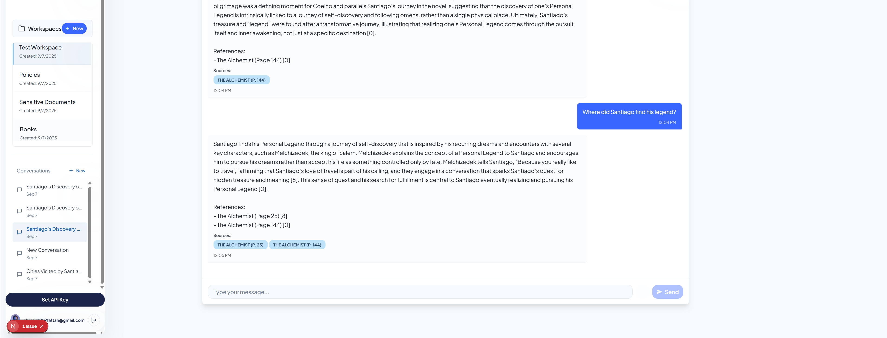

# SwordFish Quick Start Guide

This guide will help you get SwordFish up and running quickly.



## Prerequisites

- Docker and Docker Compose installed
- OpenAI API key (for embeddings generation)
- Cohere API key (for reranking functionality)
- Google OAuth credentials (for Google login functionality)

## Setup Steps

1. **Clone the repository**
   ```bash
   git clone https://github.com/yourusername/SwordFish.git
   cd SwordFish
   ```

2. **Configure environment variables**
   - Copy the example environment file:
     ```bash
     cp Fish/.env.example Fish/.env
     ```
   - Edit `Fish/.env` and add your OpenAI API key, Cohere API key, Google OAuth credentials, and other required values
   
   <!-- [SCREENSHOT PLACEHOLDER 2: Add a screenshot of the .env file with highlighted Google OAuth settings] -->

3. **Start the application**
   - For development (detached mode):
     ```bash
     ./run-dev.bat
     ```
   - For production:
     ```bash
     ./run.bat
     ```

4. **Access the application**
   - API: http://localhost:8000
   - API Documentation: http://localhost:8000/docs
   
   <!-- [SCREENSHOT PLACEHOLDER 3: Add a screenshot of the API documentation page] -->

## Basic Usage

### 1. User Authentication

#### Register a new user
```bash
curl -X POST "http://localhost:8000/users/register" \
  -H "Content-Type: application/json" \
  -d '{"email":"user@example.com","password":"securepassword"}'
```

<!-- [SCREENSHOT PLACEHOLDER 4: Add a screenshot of the registration page/form] -->

#### Login with email and password
```bash
curl -X POST "http://localhost:8000/users/login" \
  -H "Content-Type: application/x-www-form-urlencoded" \
  -d "username=user@example.com&password=securepassword"
```



#### Login with Google OAuth

1. Navigate to the login page
2. Click on the "Sign in with Google" button
3. Follow the Google authentication flow
4. You will be redirected back to the application with an active session

<!-- [SCREENSHOT PLACEHOLDER 6: Add a screenshot of the login page with Google sign-in button] -->
<!-- [SCREENSHOT PLACEHOLDER 7: Add a screenshot of the Google OAuth consent screen] -->

### 2. Workspace Management

#### Create a workspace
```bash
curl -X POST "http://localhost:8000/workspaces" \
  -H "Authorization: Bearer YOUR_TOKEN" \
  -H "Content-Type: application/json" \
  -d '{"name":"My Workspace"}'
```



### 3. Document Management

#### Upload a document
```bash
curl -X POST "http://localhost:8000/workspaces/1/sources/upload" \
  -H "Authorization: Bearer YOUR_TOKEN" \
  -F "file=@/path/to/your/document.pdf"
```




### 4. Conversation Management

#### Create a conversation
```bash
curl -X POST "http://localhost:8000/workspaces/1/conversations" \
  -H "Authorization: Bearer YOUR_TOKEN" \
  -H "Content-Type: application/json" \
  -d '{"name":"My Conversation"}'
```

<!-- [SCREENSHOT PLACEHOLDER 11: Add a screenshot of the conversation creation interface] -->

#### Send a query
```bash
curl -X POST "http://localhost:8000/workspaces/1/conversations/1/queries" \
  -H "Authorization: Bearer YOUR_TOKEN" \
  -H "Content-Type: application/json" \
  -d '{"text":"What information is in my document?"}'
```



## Technical Details

### Document Processing Pipeline

When you upload a document, SwordFish processes it through the following pipeline:

1. **Text Extraction**: Extracts text from various document formats (PDF, DOCX, TXT, etc.)
2. **Chunking**: Uses Chonker to intelligently split the document into semantically meaningful chunks
3. **Embedding Generation**: Creates vector embeddings for each chunk using OpenAI embeddings
4. **Vector Storage**: Stores embeddings in PostgreSQL with pgvector extension for efficient similarity search

### Query Processing Pipeline

When you send a query, SwordFish processes it through the following pipeline:

1. **Query Embedding**: Generates a vector embedding for your query using OpenAI embeddings
2. **Vector Search**: Performs similarity search in PostgreSQL using pgvector to find relevant chunks
3. **Reranking**: Uses Cohere Rerank 3.5 to improve search relevance by reordering results
4. **Response Generation**: Generates a response based on the most relevant chunks

## Troubleshooting

### Common Issues

1. **Docker services not starting**
   - Check Docker logs: `docker-compose logs`
   - Ensure ports 8000, 5432, and 6379 are available

2. **Database connection errors**
   - Verify database credentials in `.env`
   - Check if PostgreSQL container is running
   - Ensure pgvector extension is properly installed

3. **API key errors**
   - Ensure your OpenAI API key is valid and correctly set in `.env`
   - Verify your Cohere API key is valid and correctly set in `.env`

4. **File upload issues**
   - Check file size (limit is typically 10MB)
   - Ensure file format is supported (PDF, DOCX, TXT, etc.)

5. **Google OAuth issues**
   - Verify your Google OAuth credentials in `.env`
   - Ensure the redirect URI matches exactly what's configured in Google Cloud Console
   - Check that your application is properly registered in Google Cloud Console
   
   <!-- [SCREENSHOT PLACEHOLDER 14: Add a screenshot of the Google Cloud Console OAuth configuration] -->

### Getting Help