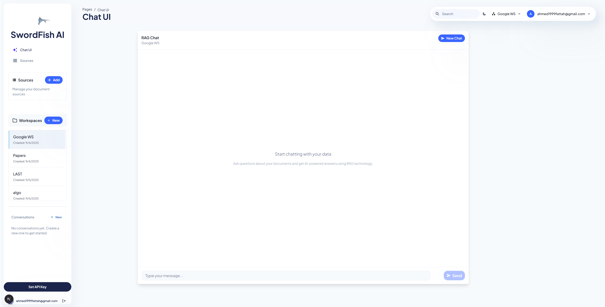
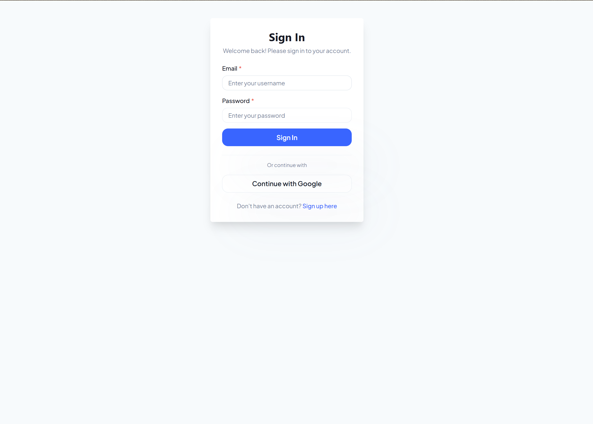
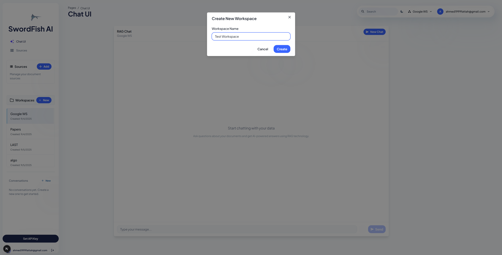
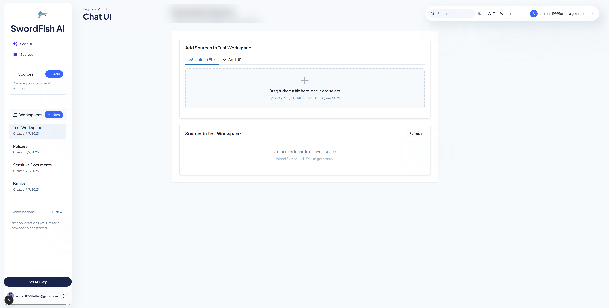
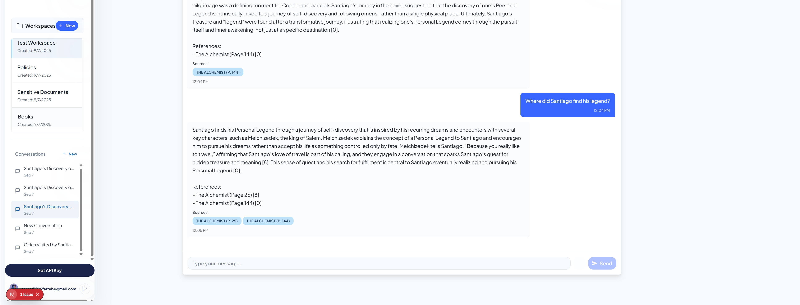

# SwordFish

## Overview
SwordFish is a Retrieval-Augmented Generation (RAG) application built with FastAPI, PostgreSQL, Redis, and Celery. It allows users to upload documents, process them into searchable chunks, and query them using natural language. The system uses chunking with Chonker, OpenAI embeddings for vector representation, Cohere Rerank 3.5 for improved search relevance, and PostgreSQL with pgvector for efficient vector storage and retrieval.



## Features
- Document upload and processing
- Text extraction and chunking with Chonker
- Vector embeddings using OpenAI embeddings
- Semantic search with Cohere Rerank 3.5
- Conversational interface for document queries
- User authentication and workspace management
  - Email/password authentication
  - Google OAuth integration
- Asynchronous task processing with Celery

## Architecture
The application follows a microservices architecture with the following components:
- **Web API**: FastAPI application serving the REST endpoints
- **Database**: PostgreSQL with pgvector extension for vector storage and similarity search
- **Cache**: Redis for task queue and result storage
- **Worker**: Celery workers for background processing
- **Text Processing**: Chonker for intelligent document chunking
- **Embeddings**: OpenAI embeddings for vector representation
- **Reranking**: Cohere Rerank 3.5 for improved search relevance

<!-- [SCREENSHOT PLACEHOLDER 2: Add a system architecture diagram here] -->

## Getting Started

### Prerequisites
- Docker and Docker Compose
- OpenAI API key
- Google OAuth credentials (for Google login functionality)
- Cohere API key (for reranking functionality)

### Setup
1. Clone the repository
2. Create a `.env` file in the `Fish` directory with the required environment variables (see below)
3. Run the application using Docker Compose

```bash
# Development mode (detached)
./run-dev.bat

# Production mode
./run.bat
```

<!-- [SCREENSHOT PLACEHOLDER 3: Add a screenshot of the application startup process] -->

### Environment Variables
Create a `.env` file in the `Fish` directory with the following variables:

```
# Project Information
PROJECT_NAME=SwordFish
PROJECT_VERSION=1.0.0
DEBUG=true

# Database Configuration
POSTGRES_USER=swordfish_user
POSTGRES_PASSWORD=swordfish_password
POSTGRES_DB=swordfish_db
POSTGRES_HOST=db
POSTGRES_PORT=5432

# Redis Configuration
REDIS_HOST=redis
REDIS_PORT=6379
REDIS_DB=0

# OpenAI Configuration
OPENAI_API_KEY=your-openai-api-key-here

# Cohere Configuration
COHERE_API_KEY=your-cohere-api-key-here

# JWT Authentication
SECRET_KEY=your-secret-key-here-change-in-production
ALGORITHM=HS256
ACCESS_TOKEN_EXPIRE_MINUTES=30

# Google OAuth (for authentication)
GOOGLE_CLIENT_ID=your-google-client-id
GOOGLE_CLIENT_SECRET=your-google-client-secret
GOOGLE_REDIRECT_URI=http://localhost:8000/auth/google/callback
```

<!-- [SCREENSHOT PLACEHOLDER 4: Add a screenshot of the .env file with highlighted Google OAuth settings] -->

## API Endpoints

### Authentication
- `POST /users/register`: Register a new user
- `POST /users/login`: Login and get access token
- `GET /users/auth/google/login`: Initiate Google OAuth flow
- `GET /users/auth/callback`: Google OAuth callback handler



### Workspaces
- `GET /workspaces`: List user workspaces
- `POST /workspaces`: Create a new workspace
- `GET /workspaces/{workspace_id}`: Get workspace details



### Sources
- `POST /workspaces/{workspace_id}/sources/upload`: Upload a document
- `GET /workspaces/{workspace_id}/sources`: List sources in a workspace
- `GET /workspaces/{workspace_id}/sources/{source_id}`: Get source details



### Conversations
- `POST /workspaces/{workspace_id}/conversations`: Create a conversation
- `GET /workspaces/{workspace_id}/conversations`: List conversations
- `POST /workspaces/{workspace_id}/conversations/{conversation_id}/queries`: Send a query



## Development

### Project Structure
```
SwordFish/
├── Fish/                  # Main application code
│   ├── alembic/           # Database migrations
│   ├── app/               # Application code
│   │   ├── api/           # API routes
│   │   ├── core/          # Core functionality
│   │   ├── db/            # Database configuration
│   │   ├── models/        # SQLAlchemy models
│   │   ├── repositories/  # Data access layer
│   │   ├── schemas/       # Pydantic schemas
│   │   ├── services/      # Business logic
│   │   ├── tasks/         # Celery tasks
│   │   └── utility/       # Utility functions
│   ├── tests/             # Test code
│   └── requirements.txt   # Python dependencies
├── docker/                # Docker configuration
│   ├── Dockerfile         # API service Dockerfile
│   ├── docker-compose.yml # Service orchestration
│   └── postgresql/        # PostgreSQL configuration
├── run.bat                # Production startup script
└── run-dev.bat           # Development startup script
```

## Testing
The application includes unit tests and load tests using pytest and Locust.

```bash
# Run unit tests
python -m pytest

```
